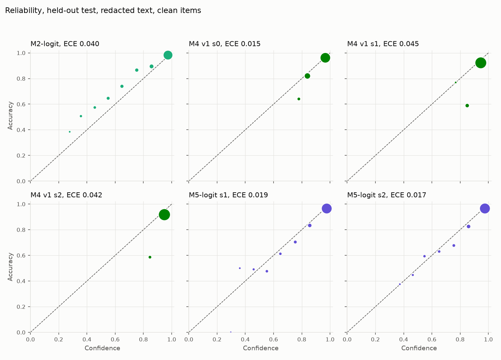
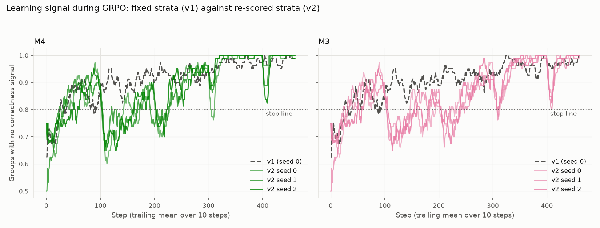
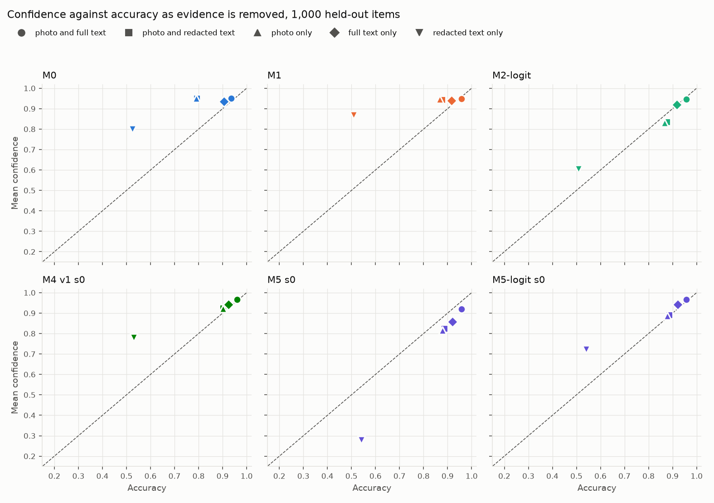

# Teaching a vision-language model to say how sure it is

A controlled study of post-training Qwen3-VL-4B for confidence that stays reliable on product categories the model never trained on.

## Summary

A product catalog can let a model fill in attributes such as neckline or sleeve length, but only if the model knows when it is likely to be wrong. This study post-trains Qwen3-VL-4B-Instruct to answer an attribute question as multiple choice and to write its confidence. It then tests whether that written confidence stays reliable on product categories the model never trained on, and when the text clues are removed so that the photo has to carry the answer.

Five conditions share one base model, one data pipeline and one evaluation: supervised fine-tuning (SFT), SFT with a post-hoc Platt map, GRPO with a correctness reward, GRPO with a calibration-aware reward, and calibrated SFT on the model's own measured success rates. An inference-only baseline reads the probability the model gives its answer letter and temperature-scales it. The primary comparison was fixed before any training: the calibration reward against that baseline, by Brier score, on held-out categories with redacted text, with 95% intervals from a paired bootstrap over product families and three training seeds.

What it found:

1. **SFT makes the model accurate, not self-aware.** After SFT it writes 0.95 on nearly every answer, a number that barely separates right answers from wrong ones (AUROC 0.63). The model's own letter probability does separate them (0.86), and temperature-scaling it is the strongest cheap fix.
2. **A calibration reward beats a correctness reward, but not the cheap baseline.** Over three seeds, GRPO with the Brier-style reward has a Brier score of 0.083 against 0.078 for the baseline, so the pre-registered test fails (difference +0.004, interval −0.003 to +0.010). It is clearly better than GRPO with a correctness reward (−0.012) and adds about a point of accuracy. Its written number takes 5–7 values, so it ranks answers less well than the letter probability (AUROC 0.80).
3. **One RL seed was not enough.** The first RL run looked like a near-win (−0.006, with the interval reaching just past zero). It turned out to be the best of three seeds: the Brier score ranged from 0.072 to 0.091 between seeds, three times the difference the first run measured.
4. **GRPO ran out of learning signal.** In every run of the first recipe, about 91% of sampled groups were all right or all wrong, so they carried no correctness signal. Re-sorting the prompts by the policy's current uncertainty made things worse: the uncertainty disappeared, and with no mistakes left, the calibration reward pushed confidence up everywhere.
5. **Calibrated SFT gives the most informative written confidence** (AUROC 0.83 in all three seeds), though it is miscalibrated. Its temperature-scaled letter probabilities had the lowest Brier score of any method in every seed, but on two fresh seeds the pre-registered test fell short (−0.005, interval −0.011 to +0.002).
6. **Written confidence mostly ignores missing or contradicting evidence.** With neither the photo nor the label in the text, accuracy falls to about 52% while the SFT and RL models still write 0.78–0.87; the letter probability falls to 0.60.

So for this task and budget the answer to the question is no. RL with a calibration-aware reward did not make the written confidence more reliable on unseen categories than temperature-scaling the model's own answer probability. The model already held a better confidence signal than any it was trained to write.

## 1. The problem

Auto-filling an attribute is worth it only when the fill is right. A model that states its confidence lets the catalog fill attributes above a threshold and leave the rest to people. For that to work, the confidence must do two things:

- **be calibrated:** of the answers stated at 0.9, about 90% are right;
- **rank answers:** wrong answers get lower confidence than right ones, so a threshold removes errors first.

The Brier score (the mean squared gap between confidence and the 0/1 outcome) rewards both. ECE measures the first and AUROC the second. Both must hold where errors are most likely: on product types the model did not train on.

Recent work trains stated confidence with RL. [RLCR](https://arxiv.org/abs/2507.16806) adds a Brier term to a correctness reward for text reasoning models, and [VL-Calibration](https://arxiv.org/abs/2604.09529) applies the idea to Qwen3-VL-4B. VL-Calibration does not compare against cheap post-hoc calibration, control the distribution shift, or remove text evidence; this study does all three. [CalibSFT](https://arxiv.org/abs/2609.32470) reports that stated confidence crowds onto a few high values and that SFT on measured success rates helps, which M5 tests here.

## 2. Design

**Data.** The Myntra fashion catalog on Kaggle: one photo and one record per product. Two attributes: neckline (9 labels) and sleeve length (4).

- **Category shift.** Training uses T-shirts, tops and shirts. The held-out test uses kurtas, kurtis, tunics, dresses, nightdresses, night suits, sweatshirts and sweaters. The label mix shifts too: Mandarin collars are 1% of training necklines and 13% of held-out ones.
- **Splits by product family.** Colour variants of a product, and listings with a byte-identical photo, always share a split.
- **Redacted text.** Every phrase naming a label, and every clause that mentions the attribute, is removed from the title and description, so the photo must carry the answer. The redaction never sees the label, and a text-only check confirms that what remains does not state it.
- **Label noise.** Items whose text names a different label than the catalog are dropped from training and from the clean test set; their rate (0–26%, by category and attribute) is reported as a noise estimate.
- **Sizes.** About 7,700 training items, 1,687 clean seen-category test items and 2,656 clean held-out ones, each scored with full and with redacted text.

**Conditions.** The model answers with `{"choice": "B", "confidence": 0.85}`; malformed output counts as wrong, with Brier loss 1.

| | Condition | Where the confidence comes from |
|---|---|---|
| M0 | Base model | Written by the model |
| M1 | LoRA SFT on the right answers; the confidence value is left out of the loss | Written |
| M2 | M1 plus a Platt map fitted on calibration data | M1's written value, remapped |
| M2-logit | M1, inference only | M1's probability of its chosen letter, temperature-scaled |
| M3 | M1 plus GRPO, reward = correctness | Written |
| M4 | M1 plus GRPO, reward = correctness − (confidence − correctness)² | Written |
| M5 | M1 plus calibrated SFT on M1's own sampled answers, each with target 0.5 × the prompt's success rate + 0.5 × the answer's correctness | Written |

Everything else is shared: LoRA rank 16 on the language model with the vision encoder frozen, the prompt, the training items, greedy decoding at evaluation. GRPO samples 8 answers per prompt at temperature 1 and takes advantages relative to the group mean without dividing by its standard deviation. A group whose 8 answers are right differs only through the stated confidences, by thousandths, and dividing by that tiny spread would turn them into full-size updates.

**Evaluation.**

- **Primary comparison, fixed before training:** M4 against M2-logit on the held-out test, redacted text, clean items, both attributes pooled. M4 counts as better if the 95% interval of the Brier difference lies below zero and its accuracy is at most 1 point worse. It was M4 against M2 until the base model turned out to write a constant, a change made before any training.
- **Intervals:** a paired bootstrap over product families (10,000 draws). Every Platt map and temperature is refitted on resampled calibration families in each draw, so the intervals include the uncertainty of fitting them.
- **Seeds:** M3, M4 and M5 were each trained with three seeds, and the comparisons use the mean over seeds. Each later test was fixed before its runs started, including the follow-up of a result found by exploring.
- **Decisions:** auto-fill thresholds chosen on seen categories (at most 5% error) are applied unchanged to the held-out categories.
- **Every decision is dated** in the [plan's decision log](plan.md), and every run in the [run log](log.md).

## 3. Results

Held-out test, redacted text, clean items, both attributes pooled. Rows with three seeds give the mean, with the lowest and highest seed in brackets.

| Method | Accuracy | Brier | ECE | AUROC | Error at the frozen threshold (target 5%) |
|---|---:|---:|---:|---:|---:|
| M0, base | 82.8% | 0.158 | 0.122 | 0.50 | (accepts 0.1%) |
| M1, SFT | 89.3% | 0.096 | 0.051 | 0.63 | 10.6% |
| M2, SFT + Platt | 89.3% | 0.099 | 0.080 | 0.75 | 10.6% |
| **M2-logit, letter probability** | 89.3% | **0.078** | 0.040 | **0.86** | 10.5% |
| M3, GRPO correctness | 89.8% | 0.095 (0.084–0.103) | 0.069 | 0.59 (0.52–0.70) | 10.2% |
| **M4, GRPO calibration** | 90.2% | **0.083** (0.072–0.091) | 0.034 (0.015–0.045) | 0.80 (0.79–0.81) | 9.7% |
| M4, recipe v2 (failed) | 89.7% | 0.095 (0.086–0.105) | 0.072 | 0.67 (0.53–0.75) | 10.3% |
| M5, calibrated SFT | 89.8% | 0.100 (0.095–0.105) | 0.067 | 0.83 (0.83–0.84) | 10.2% |
| M5-logit (exploratory) | 89.8% | 0.073 (0.071–0.075) | 0.016 | 0.85 | 10.0% |

### 3.1 SFT makes the model accurate, not self-aware

The base model writes 0.95 on almost every answer, so its written confidence has an AUROC of 0.50. SFT raises held-out accuracy from 82.8% to 89.3% with redacted text, but the written number stays near 0.95 (AUROC 0.63). A Platt map only rescales it, so within each attribute it ranks answers exactly as M1 does.

The model knows more than it writes. The probability it assigns to the letter it chooses ranks answers well (AUROC 0.86 held-out, 0.95 on seen categories), and a temperature fitted on calibration data makes it the best cheap method (Brier 0.078).

### 3.2 A calibration reward helps the written number, but not enough

Over three seeds, M4's written confidence is better than any other written confidence on the Brier score (0.083), but not better than the letter probability (0.078). The pre-registered test fails: the mean difference is +0.004, with interval −0.003 to +0.010. The three seeds give −0.006, +0.013 and +0.006.

What holds in every seed:

- **The calibration term is what keeps the number informative.** Against the correctness-only arm (M3), M4 is better on Brier (−0.012, interval −0.015 to −0.009) and 0.4 points more accurate. Without the calibration term, M3's written confidence collapsed in two of three seeds to two values, 0.98 on 93–96% of answers (AUROC 0.52–0.54).
- **RL adds about a point of accuracy:** M4 minus M1 is +0.9 points (+0.3 to +1.5).
- **The number is coarse.** M4 writes 5–7 distinct values, so it ranks answers less well than the letter probability (AUROC 0.80 against 0.86, difference −0.065, interval −0.083 to −0.045).

What did not hold: calibration. The first seed spread its written values (28% of answers below 0.9) and reached an ECE of 0.015. The other two seeds wrote 0.9 or more on 91–95% of answers, with ECE 0.042–0.045, no better than the letter probability (0.040). On one seed this looked like "RL makes the written number honest"; on three, it is a possible outcome of RL, not a reliable one.

### 3.3 Why GRPO ran out of signal

GRPO learns from differences within a group of samples for the same prompt. If all 8 answers are right, the correctness reward gives every sample the same value, and only M4's confidence term is left to learn from. The training categories are easy for the SFT model, so the RL pool was built from prompts whose sampled answers disagreed, mixed half and half with settled ones. Even so, as the policy improved, the share of groups with no correctness signal averaged 84% in the first third of training and 96–98% in the last third, in every seed.

The second recipe re-scored every prompt by the current policy's probability of the right answer and kept training on the uncertain ones. It failed in a way worth knowing:

- The uncertain prompts went from 732 at the start to 4–20 by the end; the policy became certain everywhere, so there was nothing left to find.
- With almost no wrong answers in its samples, M4's reward could only grow by stating more confidence. One seed wrote 0.98 or 0.99 on every held-out answer while right 90% of the time (AUROC 0.53).
- Over three seeds, M4 v2 was clearly worse than the baseline (Brier difference +0.017, interval +0.009 to +0.025).

The first recipe worked better because its pool kept the hard prompts fixed, so the policy kept making some mistakes to learn from. A calibration reward needs wrong answers in the batch.

### 3.4 Calibrated SFT

M5 continues M1 with SFT on M1's own sampled answers to the training prompts, right and wrong, each with a confidence target that mixes the prompt's measured success rate with the answer's correctness (as in CalibSFT). Its written confidence ranks answers better than any other written confidence, with an AUROC of 0.833–0.836 in all three seeds, the most stable result in the study. It is miscalibrated at the low end, because its training mix over-represents hard prompts: answers it writes at 0–0.12 are right 52–60% of the time.

After the first M5 run, its own letter probabilities, temperature-scaled, turned out to have the lowest held-out Brier score of any method (0.071 against 0.078). The finding was not planned, so it was written down as a hypothesis and tested on two new training seeds, with the rule of the primary comparison fixed before they ran. The new seeds point the same way (−0.003 and −0.006), with ECE 0.017–0.019 against 0.040, but their mean difference, −0.005 with interval −0.011 to +0.002, does not clear the bar. It remains a promising lead rather than a result.

### 3.5 Does confidence follow the evidence?

Two tests on the same 1,000 held-out items probe whether confidence reacts to the evidence rather than to the question.

**Taking evidence away.** Each model answered with the photo alone and with the text alone.

- The photo alone gives the same accuracy and confidence as the photo with redacted text, within a point for every model: the redacted text adds almost nothing, so the photo carries the answer, as the design intended.
- The full text alone gets 91–92% right, close to the 94–96% with photo and text: unredacted text mostly states the label.
- With only the redacted text, accuracy falls to 51–54%, and the confidence should fall with it. The written confidence of the SFT and RL models barely does: 0.87 for M1, 0.80 for M0, 0.78 for M4. Calibrated SFT over-corrects, to 0.28. The letter probability comes closest, at 0.60.

**Contradicting evidence.** Each item's photo was replaced with that of a product from the same category with a different label.

- With redacted text, every model answers with the photo's label 72–86% of the time.
- With full text that contradicts the photo, trained models follow the text more: the base model 43% of the time, SFT 62%, the RL models 64–74%, calibrated SFT 77–82%.
- Under that conflict, M4's written confidence falls 4–5 points and M3's not at all. M5's falls 20–25 points in every seed, and the letter probability's 21.

So the calibration reward makes the written number react a little to evidence, and SFT on success rates makes it react a lot, sometimes too much. The model's own letter probability reacts most sensibly of all.

### 3.6 Thresholds chosen on seen categories do not transfer

Every trained method's threshold, chosen on seen categories to keep errors at or below 5%, accepts nearly all held-out answers, with 8.6–11.5% errors. Calibration on familiar data does not carry over to new product types, even when the held-out ranking (AUROC) is good. A deployment would need some labeled data from each new category.

## 4. Conclusions

- **Read the model before training it.** The probability a model gives its own answer token is a strong confidence signal that costs nothing to obtain. No written confidence beat it: averaged over seeds, every one has a worse Brier score.
- **A calibration-aware reward is better than a correctness reward, and it is not enough.** It keeps the written number informative where a correctness reward lets it collapse, and adds a point of accuracy. But the number comes out coarse (5–7 values), its calibration depends on the run, and it ranks answers worse than the letter probability.
- **On an easy task, GRPO starves.** Most groups carry no correctness signal. A calibration reward with no mistakes in the batch rewards overconfidence, so keeping hard prompts in training matters more than re-sorting by current uncertainty.
- **One RL seed is an anecdote.** The single-seed result was a near-win, and it was the best seed of three. Between-seed spread was larger than the effect being measured, so RL claims need several seeds and a rule fixed before they run.
- **Under category shift, calibration does not transfer for free.** Thresholds fitted on seen categories let through about twice the target error on new ones, for every method.

## 5. Limitations

- **Labels are catalog labels, not verified truth.** Items whose text contradicts the label are removed, and the noise rate is reported, but the remaining labels are not hand-checked; the planned 300 photo-labeled items were not done.
- **One catalog, two attributes, one 4B model, LoRA only.** The vision encoder is frozen.
- **RL on a small budget.** One learning rate, 461 steps, no KL term, three seeds. A recipe that keeps mistakes in training (a KL anchor to the SFT model, or a fixed quota of hard prompts) was designed but not run, and could change the RL verdict.
- **One test set.** The M5-logit hypothesis was found and then tested on the same held-out set, with new training seeds. New seeds can rule out a lucky training run, not a test set that happens to favour the method.

## 6. Reproducing

All code, tests and the dated decision log are in this repository. Data and model outputs stay local (`data/`, `artifacts/`); manifests of IDs and hashes and the aggregated reports are committed. Each phase has its own report: [phase 1](../reports/phase1.md) (SFT and cheap fixes), [phase 2](../reports/phase2.md) (RL, one seed), [phase 3](../reports/phase3.md) (recipe v2, calibrated SFT, photo swap) and [phase 4](../reports/phase4.md) (three seeds, the M5-logit test, evidence runs). GPU work ran on single A40 pods that stop themselves when a run ends; the whole study cost $58.34 in GPU time and disk.
