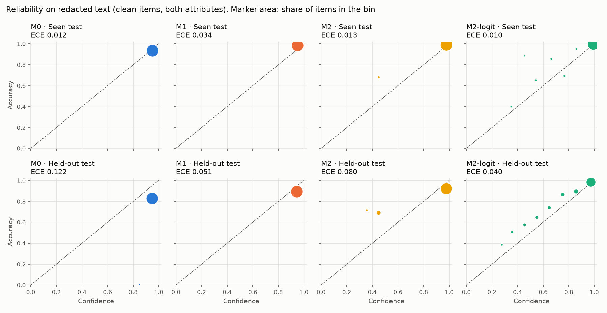
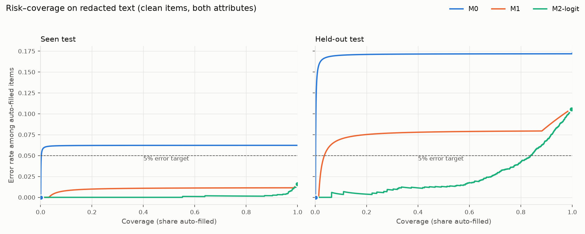

# Phase 1: base model, SFT and the cheap fixes

## M1: learning rate chosen on dev

Rule fixed before training: highest accuracy on redacted dev (invalid outputs count as wrong), then fewer invalid outputs, then the lower learning rate.

| Learning rate | Steps | Final training loss | Minutes | Redacted dev accuracy | Full dev accuracy | Invalid | Chosen |
|---|---:|---:|---:|---:|---:|---:|---|
| 5e-5 | 483 | 0.0068 | 64 | 98.1% | 98.9% | 0.0% |  |
| 1e-4 | 483 | 0.0062 | 64 | 98.1% | 98.9% | 0.0% |  |
| 2e-4 | 483 | 0.0068 | 64 | 98.4% | 98.9% | 0.0% | yes |

## Fitted maps and thresholds

Fitted on M1's calibration predictions, per attribute and text condition. Thresholds: the lowest confidence whose accepted items have at most 5% errors on the threshold half; infinity means accept nothing.

| Attribute | Text | Platt a | Platt b | Temperature | Threshold M0 | M1 | M2 | M2-logit |
|---|---|---:|---:|---:|---:|---:|---:|---:|
| neckline | full | 6.666 | -15.950 | 1.072 | 0.9500 | 0.9000 | 0.2135 | 0.2162 |
| neckline | redacted | 4.708 | -10.548 | 1.014 | inf | 0.9000 | 0.4496 | 0.2240 |
| sleeve_length | full | 9.168 | -22.340 | 1.172 | 0.9500 | 0.9500 | 0.9906 | 0.5948 |
| sleeve_length | redacted | 6.589 | -15.072 | 1.143 | 0.9800 | 0.9500 | 0.9870 | 0.5047 |

## Results, clean items

Pooled over both attributes; each attribute and text condition uses its own maps and threshold.

| Split | Text | Method | n | Accuracy | Invalid | Brier, invalid = 1 | ECE | AUROC | Risk–coverage area | Coverage at threshold | Error at threshold |
|---|---|---|---:|---:|---:|---:|---:|---:|---:|---:|---:|
| Seen test | redacted | M0 | 1,687 | 93.8% | 0.0% | 0.059 | 0.012 | 0.500 | 0.062 | 0.1% | 0.0% |
| Seen test | redacted | M1 | 1,687 | 98.4% | 0.0% | 0.016 | 0.034 | 0.655 | 0.010 | 100.0% | 1.6% |
| Seen test | redacted | M2 | 1,687 | 98.4% | 0.0% | 0.015 | 0.013 | 0.699 | 0.009 | 100.0% | 1.6% |
| Seen test | redacted | M2-logit | 1,687 | 98.4% | 0.0% | 0.013 | 0.010 | 0.949 | 0.001 | 100.0% | 1.6% |
| Seen test | full | M0 | 1,687 | 96.5% | 0.0% | 0.034 | 0.015 | 0.507 | 0.033 | 100.0% | 3.5% |
| Seen test | full | M1 | 1,687 | 99.2% | 0.0% | 0.009 | 0.037 | 0.672 | 0.004 | 100.0% | 0.8% |
| Seen test | full | M2 | 1,687 | 99.2% | 0.0% | 0.008 | 0.008 | 0.673 | 0.004 | 100.0% | 0.8% |
| Seen test | full | M2-logit | 1,687 | 99.2% | 0.0% | 0.007 | 0.005 | 0.970 | 0.000 | 99.9% | 0.8% |
| Held-out test | redacted | M0 | 2,656 | 82.8% | 0.0% | 0.158 | 0.122 | 0.503 | 0.171 | 0.1% | 0.0% |
| Held-out test | redacted | M1 | 2,656 | 89.3% | 0.0% | 0.096 | 0.051 | 0.631 | 0.077 | 99.5% | 10.6% |
| Held-out test | redacted | M2 | 2,656 | 89.3% | 0.0% | 0.099 | 0.080 | 0.747 | 0.046 | 99.5% | 10.6% |
| Held-out test | redacted | M2-logit | 2,656 | 89.3% | 0.0% | 0.078 | 0.040 | 0.862 | 0.025 | 99.7% | 10.5% |
| Held-out test | full | M0 | 2,656 | 94.7% | 0.0% | 0.051 | 0.004 | 0.504 | 0.051 | 100.0% | 5.3% |
| Held-out test | full | M1 | 2,656 | 96.5% | 0.0% | 0.032 | 0.016 | 0.719 | 0.018 | 99.8% | 3.3% |
| Held-out test | full | M2 | 2,656 | 96.5% | 0.0% | 0.030 | 0.014 | 0.788 | 0.012 | 99.8% | 3.3% |
| Held-out test | full | M2-logit | 2,656 | 96.5% | 0.0% | 0.025 | 0.015 | 0.922 | 0.004 | 99.7% | 3.3% |

## Results, all labeled items

Pooled over both attributes; each attribute and text condition uses its own maps and threshold.

| Split | Text | Method | n | Accuracy | Invalid | Brier, invalid = 1 | ECE | AUROC | Risk–coverage area | Coverage at threshold | Error at threshold |
|---|---|---|---:|---:|---:|---:|---:|---:|---:|---:|---:|
| Seen test | redacted | M0 | 1,788 | 91.6% | 0.0% | 0.079 | 0.034 | 0.500 | 0.084 | 0.1% | 0.0% |
| Seen test | redacted | M1 | 1,788 | 96.4% | 0.0% | 0.034 | 0.014 | 0.628 | 0.025 | 100.0% | 3.6% |
| Seen test | redacted | M2 | 1,788 | 96.4% | 0.0% | 0.033 | 0.010 | 0.704 | 0.019 | 100.0% | 3.6% |
| Seen test | redacted | M2-logit | 1,788 | 96.4% | 0.0% | 0.028 | 0.012 | 0.913 | 0.004 | 99.9% | 3.5% |
| Seen test | full | M0 | 1,788 | 93.1% | 0.0% | 0.065 | 0.020 | 0.507 | 0.065 | 100.0% | 6.9% |
| Seen test | full | M1 | 1,788 | 95.6% | 0.0% | 0.042 | 0.001 | 0.584 | 0.030 | 100.0% | 4.4% |
| Seen test | full | M2 | 1,788 | 95.6% | 0.0% | 0.043 | 0.032 | 0.718 | 0.019 | 100.0% | 4.4% |
| Seen test | full | M2-logit | 1,788 | 95.6% | 0.0% | 0.037 | 0.029 | 0.920 | 0.005 | 99.6% | 4.3% |
| Held-out test | redacted | M0 | 2,853 | 79.7% | 0.0% | 0.185 | 0.152 | 0.504 | 0.200 | 0.1% | 0.0% |
| Held-out test | redacted | M1 | 2,853 | 86.3% | 0.0% | 0.123 | 0.082 | 0.609 | 0.105 | 99.4% | 13.6% |
| Held-out test | redacted | M2 | 2,853 | 86.3% | 0.0% | 0.125 | 0.104 | 0.697 | 0.076 | 99.4% | 13.6% |
| Held-out test | redacted | M2-logit | 2,853 | 86.3% | 0.0% | 0.100 | 0.034 | 0.809 | 0.046 | 99.7% | 13.6% |
| Held-out test | full | M0 | 2,853 | 89.8% | 0.0% | 0.094 | 0.052 | 0.504 | 0.098 | 100.0% | 10.2% |
| Held-out test | full | M1 | 2,853 | 91.5% | 0.0% | 0.078 | 0.035 | 0.593 | 0.065 | 99.8% | 8.4% |
| Held-out test | full | M2 | 2,853 | 91.5% | 0.0% | 0.079 | 0.065 | 0.661 | 0.052 | 99.8% | 8.4% |
| Held-out test | full | M2-logit | 2,853 | 91.5% | 0.0% | 0.069 | 0.044 | 0.789 | 0.030 | 99.5% | 8.3% |

## Accuracy by category, redacted text, clean items

| Split | Category | n | M0 | M1 |
|---|---|---:|---:|---:|
| Seen test | Tshirts | 1,212 | 98.3% | 98.9% |
| Seen test | Shirts | 251 | 76.9% | 99.6% |
| Seen test | Tops | 224 | 87.9% | 94.2% |
| Held-out test | Kurtas | 1,110 | 77.9% | 89.3% |
| Held-out test | Dresses | 444 | 79.1% | 83.1% |
| Held-out test | Sweatshirts | 341 | 98.8% | 99.7% |
| Held-out test | Night suits | 227 | 89.4% | 91.2% |
| Held-out test | Nightdress | 204 | 92.6% | 86.8% |
| Held-out test | Tunics | 178 | 74.2% | 88.8% |
| Held-out test | Kurtis | 102 | 81.4% | 84.3% |
| Held-out test | Sweaters | 50 | 76.0% | 90.0% |

## Evidence sensitivity, clean items

From full to redacted text on the same items: the fall in mean confidence beside the fall in accuracy, both on the items valid in both conditions. A model that notices the missing evidence lowers its confidence about as much as its accuracy falls.

| Split | Method | n | Confidence drop | Accuracy drop | Invalid, full | Invalid, redacted |
|---|---|---:|---:|---:|---:|---:|
| Seen test | M0 | 1,687 | +0.000 | +0.027 | 0.0% | 0.0% |
| Seen test | M1 | 1,687 | +0.005 | +0.008 | 0.0% | 0.0% |
| Seen test | M2 | 1,687 | +0.013 | +0.008 | 0.0% | 0.0% |
| Seen test | M2-logit | 1,687 | +0.014 | +0.008 | 0.0% | 0.0% |
| Held-out test | M0 | 2,656 | +0.000 | +0.119 | 0.0% | 0.0% |
| Held-out test | M1 | 2,656 | +0.005 | +0.072 | 0.0% | 0.0% |
| Held-out test | M2 | 2,656 | +0.044 | +0.072 | 0.0% | 0.0% |
| Held-out test | M2-logit | 2,656 | +0.098 | +0.072 | 0.0% | 0.0% |

## M1's stated confidence

Across both test splits, M1 states 3 distinct values. Most common: 0.95 (89.6%), 0.9 (5.4%), 0.98 (5.0%).

Clip check: 0 of 12,846 stated values in M1's calibration and test runs lie outside [0.005, 0.995], the range the Platt map clips to, so the clip never binds and M2 does not depend on it.

## Letter probabilities before and after SFT

Temperatures fitted the same way on each model's own map-fitting predictions: 1 means the letter probabilities need no correction, above 1 means they are overconfident.

| Attribute | Text | Temperature, M0 | Temperature, M1 |
|---|---|---:|---:|
| neckline | full | 4.41 | 1.07 |
| neckline | redacted | 4.73 | 1.01 |
| sleeve_length | full | 5.36 | 1.17 |
| sleeve_length | redacted | 6.37 | 1.14 |

M1's letter probabilities without and with the fitted temperature, redacted text, clean items:

| Split | Brier, temperature 1 | Brier, fitted | ECE, temperature 1 | ECE, fitted |
|---|---:|---:|---:|---:|
| Seen test | 0.013 | 0.013 | 0.008 | 0.010 |
| Held-out test | 0.078 | 0.078 | 0.031 | 0.040 |

## Figures

Reliability: M1's stated values (0.9, 0.95, 0.98) all fall in one bin, so its diagram shows a single point and its ECE pools them; the Brier score and AUROC still tell them apart.

Risk–coverage: lines rank both attributes together, with ties in a random order, so a method that states one value for every item draws a flat line at its overall error rate. Dots are the outcome of each method's frozen thresholds, which are set per attribute, so a dot can sit off its line. M2 is left out: its map is increasing, so it ranks items exactly as M1 does and its curve is M1's.

## Differences with 95% intervals, redacted text, clean items

Paired bootstrap over product families (10,000 draws); every draw also refits M2's Platt map and M2-logit's temperature on a resample of the calibration families. Negative Brier differences favour the first method.

| Split | Difference | Estimate | 95% interval | Undefined draws |
|---|---|---:|---|---:|
| Seen test | Brier, M2-logit minus M2 | -0.0022 | -0.0073 to +0.0007 | 0 |
| Seen test | Brier, M2-logit minus M1 | -0.0034 | -0.0070 to +0.0001 | 0 |
| Seen test | Brier, M2 minus M1 | -0.0012 | -0.0034 to +0.0043 | 0 |
| Seen test | AUROC, M2-logit minus M1 | +0.2944 | +0.2036 to +0.3761 | 0 |
| Seen test | Accuracy, M1 minus M0 | +0.0462 | +0.0344 to +0.0591 | 0 |
| Held-out test | Brier, M2-logit minus M2 | -0.0204 | -0.0527 to -0.0091 | 0 |
| Held-out test | Brier, M2-logit minus M1 | -0.0172 | -0.0251 to -0.0082 | 0 |
| Held-out test | Brier, M2 minus M1 | +0.0032 | -0.0052 to +0.0361 | 0 |
| Held-out test | AUROC, M2-logit minus M1 | +0.2309 | +0.2013 to +0.2584 | 0 |
| Held-out test | Accuracy, M1 minus M0 | +0.0659 | +0.0509 to +0.0815 | 0 |
