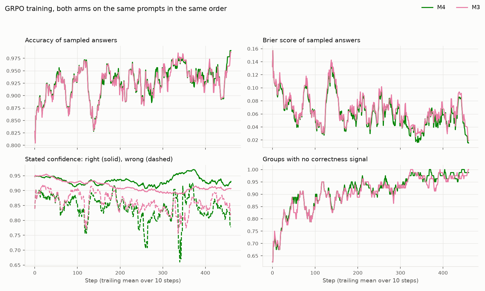
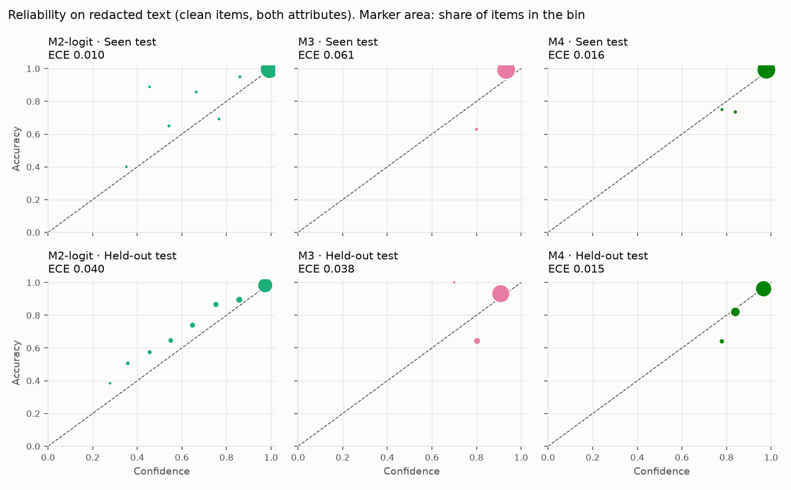
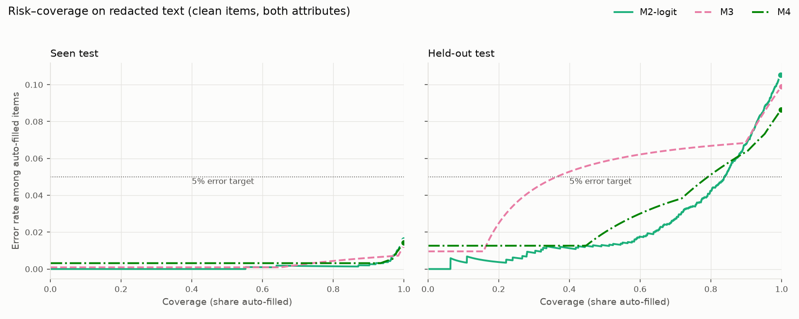

# Phase 2: RL without and with a calibration reward

## Training

Pool: 7,717 training prompts, answered 8 times each by M1 at temperature 1: 614 mixed (some answers right, some wrong) and 7,103 settled (7,053 all right, 50 all wrong). Planned steps: 461, of 4 mixed and 4 settled prompts with 8 samples each.

| Arm | Reward | Steps | Minutes | Groups with no correctness signal | Groups trained per step | Accuracy, first → last 25 steps | Brier, first → last 25 | Stated confidence when right | Stated confidence when wrong |
|---|---|---:|---:|---:|---:|---:|---:|---:|---:|
| M4 | calibration | 461 | 285 | 91.5% | 7.9 | 0.882 → 0.961 | 0.099 → 0.038 | 0.947 → 0.923 | 0.884 → 0.826 |
| M3 | correctness | 461 | 113 | 90.9% | 0.7 | 0.879 → 0.955 | 0.103 → 0.045 | 0.951 → 0.905 | 0.904 → 0.857 |

## Primary comparison (fixed before any training)

M4 against M2-logit on the held-out test, redacted text, clean items, both attributes pooled. M4 counts as better if the 95% interval of the Brier difference lies below zero and the lower bound of the accuracy difference is above −1 point.

| Difference | Estimate | 95% interval | Criterion | Met |
|---|---:|---|---|---|
| Brier, M4 minus M2-logit | -0.0061 | -0.0136 to +0.0004 | interval below 0 | no |
| Accuracy, M4 minus M2-logit | +0.0196 | +0.0112 to +0.0283 | lower bound above −0.01 | yes |

**Verdict: M4 does not count as better than M2-logit.**

## Other comparisons, redacted text, clean items

Paired bootstrap over product families (10,000 draws); every draw also refits M2's Platt map and M2-logit's temperature on a resample of the calibration families. Negative Brier differences favour the first method.

| Split | Difference | Estimate | 95% interval | Undefined draws |
|---|---|---:|---|---:|
| Seen test | Brier, M4 minus M2-logit | -0.0007 | -0.0036 to +0.0021 | 0 |
| Seen test | Accuracy, M4 minus M2-logit | +0.0018 | -0.0024 to +0.0062 | 0 |
| Seen test | Brier, M4 minus M3 | -0.0025 | -0.0042 to -0.0004 | 0 |
| Seen test | Brier, M4 minus M2 | -0.0029 | -0.0085 to +0.0003 | 0 |
| Seen test | Brier, M3 minus M2-logit | +0.0018 | -0.0009 to +0.0044 | 0 |
| Seen test | AUROC, M4 minus M2-logit | -0.0736 | -0.1489 to -0.0065 | 0 |
| Seen test | AUROC, M4 minus M3 | -0.0039 | -0.0783 to +0.0675 | 0 |
| Seen test | Accuracy, M4 minus M3 | -0.0012 | -0.0036 to +0.0012 | 0 |
| Seen test | Accuracy, M3 minus M1 | +0.0030 | -0.0012 to +0.0074 | 0 |
| Held-out test | Brier, M4 minus M2-logit | -0.0061 | -0.0136 to +0.0004 | 0 |
| Held-out test | Accuracy, M4 minus M2-logit | +0.0196 | +0.0112 to +0.0283 | 0 |
| Held-out test | Brier, M4 minus M3 | -0.0114 | -0.0164 to -0.0065 | 0 |
| Held-out test | Brier, M4 minus M2 | -0.0264 | -0.0590 to -0.0159 | 0 |
| Held-out test | Brier, M3 minus M2-logit | +0.0053 | -0.0021 to +0.0118 | 0 |
| Held-out test | AUROC, M4 minus M2-logit | -0.0725 | -0.0959 to -0.0477 | 0 |
| Held-out test | AUROC, M4 minus M3 | +0.0884 | +0.0619 to +0.1150 | 0 |
| Held-out test | Accuracy, M4 minus M3 | +0.0120 | +0.0053 to +0.0189 | 0 |
| Held-out test | Accuracy, M3 minus M1 | +0.0075 | +0.0015 to +0.0137 | 0 |

## Results, clean items

Pooled over both attributes; each attribute and text condition uses its own maps and threshold.

| Split | Text | Method | n | Accuracy | Invalid | Brier, invalid = 1 | ECE | AUROC | Risk–coverage area | Coverage at threshold | Error at threshold |
|---|---|---|---:|---:|---:|---:|---:|---:|---:|---:|---:|
| Seen test | redacted | M0 | 1,687 | 93.8% | 0.0% | 0.059 | 0.012 | 0.500 | 0.062 | 0.1% | 0.0% |
| Seen test | redacted | M1 | 1,687 | 98.4% | 0.0% | 0.016 | 0.034 | 0.655 | 0.010 | 100.0% | 1.6% |
| Seen test | redacted | M2 | 1,687 | 98.4% | 0.0% | 0.015 | 0.013 | 0.699 | 0.009 | 100.0% | 1.6% |
| Seen test | redacted | M2-logit | 1,687 | 98.4% | 0.0% | 0.013 | 0.010 | 0.949 | 0.001 | 100.0% | 1.6% |
| Seen test | redacted | M3 | 1,687 | 98.7% | 0.0% | 0.015 | 0.061 | 0.879 | 0.002 | 100.0% | 1.3% |
| Seen test | redacted | M4 | 1,687 | 98.6% | 0.0% | 0.012 | 0.016 | 0.875 | 0.003 | 100.0% | 1.4% |
| Seen test | full | M0 | 1,687 | 96.5% | 0.0% | 0.034 | 0.015 | 0.507 | 0.033 | 100.0% | 3.5% |
| Seen test | full | M1 | 1,687 | 99.2% | 0.0% | 0.009 | 0.037 | 0.672 | 0.004 | 100.0% | 0.8% |
| Seen test | full | M2 | 1,687 | 99.2% | 0.0% | 0.008 | 0.008 | 0.673 | 0.004 | 100.0% | 0.8% |
| Seen test | full | M2-logit | 1,687 | 99.2% | 0.0% | 0.007 | 0.005 | 0.970 | 0.000 | 99.9% | 0.8% |
| Seen test | full | M3 | 1,687 | 99.2% | 0.0% | 0.010 | 0.051 | 0.906 | 0.001 | 99.9% | 0.8% |
| Seen test | full | M4 | 1,687 | 99.2% | 0.0% | 0.007 | 0.017 | 0.839 | 0.002 | 99.9% | 0.8% |
| Held-out test | redacted | M0 | 2,656 | 82.8% | 0.0% | 0.158 | 0.122 | 0.503 | 0.171 | 0.1% | 0.0% |
| Held-out test | redacted | M1 | 2,656 | 89.3% | 0.0% | 0.096 | 0.051 | 0.631 | 0.077 | 99.5% | 10.6% |
| Held-out test | redacted | M2 | 2,656 | 89.3% | 0.0% | 0.099 | 0.080 | 0.747 | 0.046 | 99.5% | 10.6% |
| Held-out test | redacted | M2-logit | 2,656 | 89.3% | 0.0% | 0.078 | 0.040 | 0.862 | 0.025 | 99.7% | 10.5% |
| Held-out test | redacted | M3 | 2,656 | 90.1% | 0.0% | 0.084 | 0.038 | 0.701 | 0.050 | 100.0% | 9.9% |
| Held-out test | redacted | M4 | 2,656 | 91.3% | 0.0% | 0.072 | 0.015 | 0.789 | 0.030 | 99.8% | 8.6% |
| Held-out test | full | M0 | 2,656 | 94.7% | 0.0% | 0.051 | 0.004 | 0.504 | 0.051 | 100.0% | 5.3% |
| Held-out test | full | M1 | 2,656 | 96.5% | 0.0% | 0.032 | 0.016 | 0.719 | 0.018 | 99.8% | 3.3% |
| Held-out test | full | M2 | 2,656 | 96.5% | 0.0% | 0.030 | 0.014 | 0.788 | 0.012 | 99.8% | 3.3% |
| Held-out test | full | M2-logit | 2,656 | 96.5% | 0.0% | 0.025 | 0.015 | 0.922 | 0.004 | 99.7% | 3.3% |
| Held-out test | full | M3 | 2,656 | 96.8% | 0.0% | 0.030 | 0.064 | 0.845 | 0.007 | 99.9% | 3.2% |
| Held-out test | full | M4 | 2,656 | 97.1% | 0.0% | 0.024 | 0.019 | 0.880 | 0.007 | 99.9% | 2.8% |

## Results, all labeled items

Pooled over both attributes; each attribute and text condition uses its own maps and threshold.

| Split | Text | Method | n | Accuracy | Invalid | Brier, invalid = 1 | ECE | AUROC | Risk–coverage area | Coverage at threshold | Error at threshold |
|---|---|---|---:|---:|---:|---:|---:|---:|---:|---:|---:|
| Seen test | redacted | M0 | 1,788 | 91.6% | 0.0% | 0.079 | 0.034 | 0.500 | 0.084 | 0.1% | 0.0% |
| Seen test | redacted | M1 | 1,788 | 96.4% | 0.0% | 0.034 | 0.014 | 0.628 | 0.025 | 100.0% | 3.6% |
| Seen test | redacted | M2 | 1,788 | 96.4% | 0.0% | 0.033 | 0.010 | 0.704 | 0.019 | 100.0% | 3.6% |
| Seen test | redacted | M2-logit | 1,788 | 96.4% | 0.0% | 0.028 | 0.012 | 0.913 | 0.004 | 99.9% | 3.5% |
| Seen test | redacted | M3 | 1,788 | 96.5% | 0.0% | 0.033 | 0.044 | 0.796 | 0.012 | 100.0% | 3.5% |
| Seen test | redacted | M4 | 1,788 | 96.3% | 0.0% | 0.032 | 0.009 | 0.814 | 0.014 | 100.0% | 3.7% |
| Seen test | full | M0 | 1,788 | 93.1% | 0.0% | 0.065 | 0.020 | 0.507 | 0.065 | 100.0% | 6.9% |
| Seen test | full | M1 | 1,788 | 95.6% | 0.0% | 0.042 | 0.001 | 0.584 | 0.030 | 100.0% | 4.4% |
| Seen test | full | M2 | 1,788 | 95.6% | 0.0% | 0.043 | 0.032 | 0.718 | 0.019 | 100.0% | 4.4% |
| Seen test | full | M2-logit | 1,788 | 95.6% | 0.0% | 0.037 | 0.029 | 0.920 | 0.005 | 99.6% | 4.3% |
| Seen test | full | M3 | 1,788 | 95.7% | 0.0% | 0.039 | 0.017 | 0.773 | 0.018 | 99.8% | 4.3% |
| Seen test | full | M4 | 1,788 | 95.8% | 0.0% | 0.039 | 0.019 | 0.680 | 0.027 | 99.8% | 4.2% |
| Held-out test | redacted | M0 | 2,853 | 79.7% | 0.0% | 0.185 | 0.152 | 0.504 | 0.200 | 0.1% | 0.0% |
| Held-out test | redacted | M1 | 2,853 | 86.3% | 0.0% | 0.123 | 0.082 | 0.609 | 0.105 | 99.4% | 13.6% |
| Held-out test | redacted | M2 | 2,853 | 86.3% | 0.0% | 0.125 | 0.104 | 0.697 | 0.076 | 99.4% | 13.6% |
| Held-out test | redacted | M2-logit | 2,853 | 86.3% | 0.0% | 0.100 | 0.034 | 0.809 | 0.046 | 99.7% | 13.6% |
| Held-out test | redacted | M3 | 2,853 | 86.9% | 0.0% | 0.108 | 0.027 | 0.677 | 0.075 | 99.9% | 13.1% |
| Held-out test | redacted | M4 | 2,853 | 88.3% | 0.0% | 0.096 | 0.043 | 0.751 | 0.052 | 99.8% | 11.6% |
| Held-out test | full | M0 | 2,853 | 89.8% | 0.0% | 0.094 | 0.052 | 0.504 | 0.098 | 100.0% | 10.2% |
| Held-out test | full | M1 | 2,853 | 91.5% | 0.0% | 0.078 | 0.035 | 0.593 | 0.065 | 99.8% | 8.4% |
| Held-out test | full | M2 | 2,853 | 91.5% | 0.0% | 0.079 | 0.065 | 0.661 | 0.052 | 99.8% | 8.4% |
| Held-out test | full | M2-logit | 2,853 | 91.5% | 0.0% | 0.069 | 0.044 | 0.789 | 0.030 | 99.5% | 8.3% |
| Held-out test | full | M3 | 2,853 | 91.7% | 0.0% | 0.072 | 0.014 | 0.706 | 0.043 | 99.8% | 8.3% |
| Held-out test | full | M4 | 2,853 | 92.2% | 0.0% | 0.069 | 0.045 | 0.694 | 0.048 | 99.8% | 7.7% |

## AUROC within each attribute, redacted text, clean items

Pooled AUROC also compares answers across the two attributes, so it partly rewards knowing which attribute is easier; within one attribute it measures only which answers of the same kind are riskier.

| Split | Attribute | n | M0 | M1 | M2 | M2-logit | M3 | M4 |
|---|---|---:|---:|---:|---:|---:|---:|---:|
| Seen test | neckline | 667 | 0.500 | 0.710 | 0.710 | 0.939 | 0.844 | 0.867 |
| Seen test | sleeve_length | 1,020 | 0.501 | 0.526 | 0.526 | 0.949 | 0.909 | 0.866 |
| Held-out test | neckline | 1,232 | 0.503 | 0.593 | 0.593 | 0.781 | 0.652 | 0.726 |
| Held-out test | sleeve_length | 1,424 | 0.501 | 0.551 | 0.551 | 0.838 | 0.650 | 0.750 |

## Evidence sensitivity, clean items

From full to redacted text on the same items: the fall in mean confidence beside the fall in accuracy, both on the items valid in both conditions.

| Split | Method | n | Confidence drop | Accuracy drop | Invalid, full | Invalid, redacted |
|---|---|---:|---:|---:|---:|---:|
| Seen test | M0 | 1,687 | +0.000 | +0.027 | 0.0% | 0.0% |
| Seen test | M1 | 1,687 | +0.005 | +0.008 | 0.0% | 0.0% |
| Seen test | M2 | 1,687 | +0.013 | +0.008 | 0.0% | 0.0% |
| Seen test | M2-logit | 1,687 | +0.014 | +0.008 | 0.0% | 0.0% |
| Seen test | M3 | 1,687 | +0.011 | +0.005 | 0.0% | 0.0% |
| Seen test | M4 | 1,687 | +0.004 | +0.007 | 0.0% | 0.0% |
| Held-out test | M0 | 2,656 | +0.000 | +0.119 | 0.0% | 0.0% |
| Held-out test | M1 | 2,656 | +0.005 | +0.072 | 0.0% | 0.0% |
| Held-out test | M2 | 2,656 | +0.044 | +0.072 | 0.0% | 0.0% |
| Held-out test | M2-logit | 2,656 | +0.098 | +0.072 | 0.0% | 0.0% |
| Held-out test | M3 | 2,656 | +0.024 | +0.067 | 0.0% | 0.0% |
| Held-out test | M4 | 2,656 | +0.040 | +0.058 | 0.0% | 0.0% |

## Stated confidence

Across both test splits and both text conditions:

| Model | Distinct values | Most common | Below 0.9 |
|---|---:|---|---:|
| M1 | 3 | 0.95 (89.6%), 0.9 (5.4%), 0.98 (5.0%) | 0.0% |
| M3 | 5 | 0.9 (48.0%), 0.95 (47.0%), 0.8 (4.8%), 0.85 (0.2%) | 5.0% |
| M4 | 7 | 0.98 (75.2%), 0.95 (10.7%), 0.85 (7.7%), 0.78 (2.3%) | 12.2% |

## The Brier score, decomposed (exploratory)

Held-out test, redacted text, clean items. Brier = calibration − resolution + uncertainty (Murphy). Calibration is the gap between a group's confidence and its hit rate; resolution is how far the groups' hit rates spread from the overall one; uncertainty is a(1 − a) for accuracy a, so it depends only on the answers. Written confidences are grouped by value, which makes the decomposition exact; letter probabilities, which are continuous, are grouped into 50 equal bins.

| Method | Brier | Calibration | Resolution | Uncertainty | Groups |
|---|---:|---:|---:|---:|---:|
| M0 | 0.1576 | 0.0154 | 0.0005 | 0.1427 | 3 |
| M1 | 0.0956 | 0.0060 | 0.0056 | 0.0952 | 3 |
| M2 | 0.0988 | 0.0123 | 0.0087 | 0.0952 | 6 |
| M2-logit | 0.0784 | 0.0051 | 0.0219 | 0.0952 | 39 |
| M3 | 0.0838 | 0.0035 | 0.0089 | 0.0892 | 5 |
| M4 | 0.0723 | 0.0013 | 0.0084 | 0.0794 | 7 |

## How often each written value is right, held-out test, redacted text, clean items

Values written fewer than 20 times are left out.

| Model | Written confidence | Answers | Right |
|---|---:|---:|---:|
| M1 | 0.9 | 314 | 69.1% |
| M1 | 0.95 | 2,306 | 91.9% |
| M1 | 0.98 | 36 | 100.0% |
| M3 | 0.8 | 268 | 63.1% |
| M3 | 0.9 | 1,954 | 91.9% |
| M3 | 0.95 | 418 | 99.0% |
| M4 | 0.78 | 124 | 64.5% |
| M4 | 0.8 | 126 | 75.4% |
| M4 | 0.85 | 496 | 83.7% |
| M4 | 0.92 | 126 | 92.1% |
| M4 | 0.95 | 593 | 91.9% |
| M4 | 0.98 | 1,187 | 98.7% |

## Does the written confidence follow the model's own letter probability? (exploratory)

Rank correlation, on the held-out test (redacted text, clean items, valid outputs), between the confidence a model writes and the probability it gives the letter it chose. 1 would mean the written number orders answers exactly as the model's internal probability does. Not part of the pre-registered comparisons.

| Model | n | Rank correlation |
|---|---:|---:|
| M1 | 2,656 | 0.507 |
| M3 | 2,656 | 0.623 |
| M4 | 2,656 | 0.866 |

## Held-out test by category, redacted text, clean items (exploratory)

| Category | n | Accuracy, M1 | Accuracy, M3 | Accuracy, M4 | Brier, M2-logit | Brier, M3 | Brier, M4 |
|---|---:|---:|---:|---:|---:|---:|---:|
| Kurtas | 1,110 | 89.3% | 90.4% | 91.2% | 0.079 | 0.083 | 0.075 |
| Dresses | 444 | 83.1% | 84.2% | 86.3% | 0.114 | 0.128 | 0.110 |
| Sweatshirts | 341 | 99.7% | 99.4% | 99.7% | 0.002 | 0.008 | 0.002 |
| Night suits | 227 | 91.2% | 90.7% | 92.1% | 0.070 | 0.082 | 0.063 |
| Nightdress | 204 | 86.8% | 89.2% | 89.7% | 0.114 | 0.090 | 0.087 |
| Tunics | 178 | 88.8% | 88.8% | 91.0% | 0.088 | 0.092 | 0.077 |
| Kurtis | 102 | 84.3% | 84.3% | 89.2% | 0.105 | 0.126 | 0.086 |
| Sweaters | 50 | 90.0% | 90.0% | 90.0% | 0.079 | 0.092 | 0.098 |

## Thresholds

Each method's frozen auto-fill threshold, chosen on its threshold-half predictions (infinity: accept nothing).

| Attribute | Text | M0 | M1 | M2 | M2-logit | M3 | M4 |
|---|---|---:|---:|---:|---:|---:|---:|
| neckline | full | 0.9500 | 0.9000 | 0.2135 | 0.2162 | 0.8000 | 0.7800 |
| neckline | redacted | inf | 0.9000 | 0.4496 | 0.2240 | 0.8000 | 0.7800 |
| sleeve_length | full | 0.9500 | 0.9500 | 0.9906 | 0.5948 | 0.9000 | 0.8500 |
| sleeve_length | redacted | 0.9800 | 0.9500 | 0.9870 | 0.5047 | 0.8000 | 0.7800 |

## Figures

Risk–coverage: lines rank both attributes together, ties in a random order. Dots are the outcome of each method's frozen thresholds. M0, M1 and M2 are in reports/phase1.md and the tables above.
