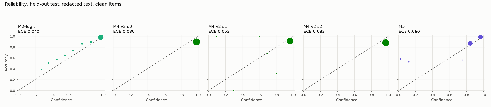

# Phase 3: GRPO recipe v2 over three seeds, M5, and the photo swap

## Training

Recipe v2 re-scores every prompt with the current policy every 50 steps; a prompt is mixed if 8 samples would hold both right and wrong answers with probability at least 0.2. v1 rows are Milestone 4's runs, whose strata were fixed at the start.

| Arm | Steps | Minutes | Groups with no correctness signal: all, first third, last third | Groups trained per step | Mixed prompts at the first and last re-scoring | Accuracy, first → last 25 | Brier, first → last 25 |
|---|---:|---:|---|---:|---|---|---|
| M4 v1 | 461 | 285 | 91.5%, 84.7%, 97.6% | 7.9 | – | 0.882 → 0.961 | 0.099 → 0.038 |
| M4 v2 s0 | 461 | 368 | 87.8%, 78.8%, 99.0% | 7.1 | 732 → 4 | 0.876 → 1.000 | 0.108 → 0.000 |
| M4 v2 s1 | 461 | 371 | 88.3%, 80.5%, 99.1% | 7.2 | 732 → 13 | 0.874 → 0.960 | 0.107 → 0.037 |
| M4 v2 s2 | 461 | 378 | 87.7%, 77.7%, 98.5% | 7.3 | 732 → 14 | 0.892 → 0.964 | 0.092 → 0.033 |
| M3 v1 | 461 | 113 | 90.9%, 84.2%, 96.8% | 0.7 | – | 0.879 → 0.955 | 0.103 → 0.045 |
| M3 v2 s0 | 461 | 219 | 86.1%, 79.4%, 96.3% | 1.1 | 732 → 9 | 0.873 → 1.000 | 0.111 → 0.003 |
| M3 v2 s1 | 461 | 219 | 86.1%, 79.7%, 95.6% | 1.1 | 732 → 20 | 0.874 → 0.994 | 0.107 → 0.008 |
| M3 v2 s2 | 461 | 218 | 86.2%, 78.3%, 97.0% | 1.1 | 732 → 17 | 0.892 → 1.000 | 0.093 → 0.009 |

## Primary comparison (fixed before any Milestone 5 run)

The mean over seeds 0–2 of the M4 v2 minus M2-logit difference, held-out test, redacted text, clean items, both attributes pooled. M4 counts as better if the 95% interval of the Brier difference lies below zero and the lower bound of the accuracy difference is above −1 point.

| Difference | Estimate | 95% interval | Criterion | Met |
|---|---:|---|---|---|
| Brier, M4 v2 minus M2-logit, mean of seeds | +0.0173 | +0.0087 to +0.0248 | interval below 0 | no |
| Accuracy, M4 v2 minus M2-logit, mean of seeds | +0.0031 | -0.0028 to +0.0092 | lower bound above −0.01 | yes |

**Verdict: M4 v2 does not count as better than M2-logit.**

## Other comparisons, redacted text, clean items

Paired family bootstrap (10,000 draws), the same draws for every seed; every draw also refits M2's map and M2-logit's temperature. Negative Brier differences favour the first method.

| Split | Difference | Estimate | 95% interval | Undefined draws |
|---|---|---:|---|---:|
| Seen test | Brier, M4 v2 minus M2-logit, mean of seeds | +0.0001 | -0.0029 to +0.0032 | 0 |
| Seen test | Accuracy, M4 v2 minus M2-logit, mean of seeds | +0.0020 | -0.0016 to +0.0059 | 0 |
| Seen test | Brier, M4 v2 minus M3 v2, mean of seeds | -0.0024 | -0.0037 to -0.0011 | 0 |
| Seen test | AUROC, M4 v2 minus M2-logit, mean of seeds | -0.1448 | -0.1929 to -0.0960 | 0 |
| Seen test | Brier, M5 minus M2-logit | +0.0097 | +0.0041 to +0.0158 | 0 |
| Seen test | Brier, M5 minus M4 v2 (mean of seeds) | +0.0096 | +0.0038 to +0.0158 | 0 |
| Seen test | AUROC, M5 minus M2-logit | -0.0183 | -0.0562 to +0.0239 | 0 |
| Seen test | Accuracy, M5 minus M1 | +0.0012 | -0.0036 to +0.0061 | 0 |
| Seen test | Brier, M4 v2 s0 minus M2-logit | +0.0003 | -0.0032 to +0.0039 | 0 |
| Seen test | Brier, M4 v2 s1 minus M2-logit | -0.0013 | -0.0044 to +0.0018 | 0 |
| Seen test | Brier, M4 v2 s2 minus M2-logit | +0.0013 | -0.0022 to +0.0052 | 0 |
| Seen test | Brier, M5 + Platt minus M2-logit (exploratory) | +0.0013 | -0.0026 to +0.0080 | 0 |
| Seen test | Brier, M5-logit minus M2-logit (exploratory) | -0.0009 | -0.0032 to +0.0018 | 0 |
| Seen test | AUROC, M5-logit minus M2-logit (exploratory) | -0.0022 | -0.0440 to +0.0207 | 0 |
| Held-out test | Brier, M4 v2 minus M2-logit, mean of seeds | +0.0173 | +0.0087 to +0.0248 | 0 |
| Held-out test | Accuracy, M4 v2 minus M2-logit, mean of seeds | +0.0031 | -0.0028 to +0.0092 | 0 |
| Held-out test | Brier, M4 v2 minus M3 v2, mean of seeds | +0.0068 | +0.0041 to +0.0096 | 0 |
| Held-out test | AUROC, M4 v2 minus M2-logit, mean of seeds | -0.1920 | -0.2090 to -0.1719 | 0 |
| Held-out test | Brier, M5 minus M2-logit | +0.0167 | +0.0082 to +0.0246 | 0 |
| Held-out test | Brier, M5 minus M4 v2 (mean of seeds) | -0.0006 | -0.0091 to +0.0079 | 0 |
| Held-out test | AUROC, M5 minus M2-logit | -0.0282 | -0.0453 to -0.0079 | 0 |
| Held-out test | Accuracy, M5 minus M1 | +0.0068 | +0.0004 to +0.0133 | 0 |
| Held-out test | Brier, M4 v2 s0 minus M2-logit | +0.0170 | +0.0075 to +0.0256 | 0 |
| Held-out test | Brier, M4 v2 s1 minus M2-logit | +0.0079 | -0.0004 to +0.0153 | 0 |
| Held-out test | Brier, M4 v2 s2 minus M2-logit | +0.0269 | +0.0174 to +0.0356 | 0 |
| Held-out test | Brier, M5 + Platt minus M2-logit (exploratory) | +0.0053 | -0.0034 to +0.0167 | 0 |
| Held-out test | Brier, M5-logit minus M2-logit (exploratory) | -0.0070 | -0.0127 to -0.0015 | 0 |
| Held-out test | AUROC, M5-logit minus M2-logit (exploratory) | -0.0096 | -0.0252 to +0.0061 | 0 |

## Results, held-out and seen test, redacted text, clean items

Pooled over both attributes; each attribute and text condition uses its own maps and threshold. The two exploratory M5 rows were added after the results were seen, and are not part of the pre-registered comparisons: a Platt map on M5's written confidence, and M5's own letter probabilities with a temperature, both fitted on M5's map-fitting predictions.

| Split | Method | Accuracy | Brier, invalid = 1 | ECE | AUROC | Risk–coverage area | Coverage at threshold | Error at threshold |
|---|---|---:|---:|---:|---:|---:|---:|---:|
| Seen test | M0 | 93.8% | 0.059 | 0.012 | 0.500 | 0.062 | 0.1% | 0.0% |
| Seen test | M1 | 98.4% | 0.016 | 0.034 | 0.655 | 0.010 | 100.0% | 1.6% |
| Seen test | M2 | 98.4% | 0.015 | 0.013 | 0.699 | 0.009 | 100.0% | 1.6% |
| Seen test | M2-logit | 98.4% | 0.013 | 0.010 | 0.949 | 0.001 | 100.0% | 1.6% |
| Seen test | M3 v1 | 98.7% | 0.015 | 0.061 | 0.879 | 0.002 | 100.0% | 1.3% |
| Seen test | M4 v1 | 98.6% | 0.012 | 0.016 | 0.875 | 0.003 | 100.0% | 1.4% |
| Seen test | M3 v2 s0 | 98.6% | 0.015 | 0.036 | 0.500 | 0.014 | 100.0% | 1.4% |
| Seen test | M3 v2 s1 | 98.6% | 0.015 | 0.036 | 0.500 | 0.014 | 100.0% | 1.4% |
| Seen test | M3 v2 s2 | 98.6% | 0.017 | 0.058 | 0.757 | 0.005 | 100.0% | 1.4% |
| Seen test | M4 v2 s0 | 98.6% | 0.013 | 0.002 | 0.683 | 0.006 | 100.0% | 1.4% |
| Seen test | M4 v2 s1 | 98.7% | 0.012 | 0.013 | 0.838 | 0.004 | 99.9% | 1.3% |
| Seen test | M4 v2 s2 | 98.5% | 0.014 | 0.002 | 0.892 | 0.003 | 100.0% | 1.5% |
| Seen test | M5 | 98.5% | 0.023 | 0.029 | 0.931 | 0.002 | 100.0% | 1.5% |
| Seen test | M5 + Platt (exploratory) | 98.5% | 0.014 | 0.011 | 0.927 | 0.002 | 100.0% | 1.5% |
| Seen test | M5-logit (exploratory) | 98.5% | 0.012 | 0.010 | 0.947 | 0.001 | 99.8% | 1.5% |
| Held-out test | M0 | 82.8% | 0.158 | 0.122 | 0.503 | 0.171 | 0.1% | 0.0% |
| Held-out test | M1 | 89.3% | 0.096 | 0.051 | 0.631 | 0.077 | 99.5% | 10.6% |
| Held-out test | M2 | 89.3% | 0.099 | 0.080 | 0.747 | 0.046 | 99.5% | 10.6% |
| Held-out test | M2-logit | 89.3% | 0.078 | 0.040 | 0.862 | 0.025 | 99.7% | 10.5% |
| Held-out test | M3 v1 | 90.1% | 0.084 | 0.038 | 0.701 | 0.050 | 100.0% | 9.9% |
| Held-out test | M4 v1 | 91.3% | 0.072 | 0.015 | 0.789 | 0.030 | 99.8% | 8.6% |
| Held-out test | M3 v2 s0 | 90.4% | 0.089 | 0.046 | 0.500 | 0.096 | 100.0% | 9.6% |
| Held-out test | M3 v2 s1 | 90.4% | 0.089 | 0.046 | 0.500 | 0.096 | 100.0% | 9.6% |
| Held-out test | M3 v2 s2 | 90.0% | 0.089 | 0.007 | 0.567 | 0.072 | 100.0% | 10.0% |
| Held-out test | M4 v2 s0 | 90.1% | 0.095 | 0.080 | 0.530 | 0.083 | 100.0% | 9.9% |
| Held-out test | M4 v2 s1 | 90.4% | 0.086 | 0.053 | 0.729 | 0.042 | 99.7% | 9.6% |
| Held-out test | M4 v2 s2 | 88.5% | 0.105 | 0.083 | 0.750 | 0.043 | 100.0% | 11.5% |
| Held-out test | M5 | 90.0% | 0.095 | 0.060 | 0.833 | 0.028 | 100.0% | 10.0% |
| Held-out test | M5 + Platt (exploratory) | 90.0% | 0.084 | 0.052 | 0.837 | 0.027 | 100.0% | 10.0% |
| Held-out test | M5-logit (exploratory) | 90.0% | 0.071 | 0.012 | 0.852 | 0.025 | 99.6% | 9.8% |

## The Brier score, decomposed (exploratory)

Held-out test, redacted text, clean items. Brier = calibration − resolution + uncertainty; written confidences grouped by value (exact), letter probabilities in 50 equal bins.

| Method | Brier | Calibration | Resolution | Uncertainty | Groups |
|---|---:|---:|---:|---:|---:|
| M0 | 0.1576 | 0.0154 | 0.0005 | 0.1427 | 3 |
| M1 | 0.0956 | 0.0060 | 0.0056 | 0.0952 | 3 |
| M2 | 0.0988 | 0.0123 | 0.0087 | 0.0952 | 6 |
| M2-logit | 0.0784 | 0.0051 | 0.0219 | 0.0952 | 39 |
| M3 v1 | 0.0838 | 0.0035 | 0.0089 | 0.0892 | 5 |
| M4 v1 | 0.0723 | 0.0013 | 0.0084 | 0.0794 | 7 |
| M3 v2 s0 | 0.0886 | 0.0021 | 0.0000 | 0.0865 | 1 |
| M3 v2 s1 | 0.0889 | 0.0021 | 0.0000 | 0.0868 | 1 |
| M3 v2 s2 | 0.0892 | 0.0004 | 0.0013 | 0.0901 | 3 |
| M4 v2 s0 | 0.0954 | 0.0068 | 0.0006 | 0.0892 | 2 |
| M4 v2 s1 | 0.0864 | 0.0072 | 0.0080 | 0.0871 | 9 |
| M4 v2 s2 | 0.1053 | 0.0137 | 0.0100 | 0.1016 | 3 |
| M5 | 0.0952 | 0.0211 | 0.0158 | 0.0898 | 10 |
| M5 + Platt (exploratory) | 0.0838 | 0.0106 | 0.0167 | 0.0898 | 18 |
| M5-logit (exploratory) | 0.0714 | 0.0028 | 0.0212 | 0.0898 | 36 |

## How often each written value is right, held-out test, redacted text, clean items

Values written fewer than 20 times are left out.

| Model | Written confidence | Answers | Right |
|---|---:|---:|---:|
| M4 v2 s0 | 0.98 | 2,513 | 89.5% |
| M4 v2 s0 | 0.99 | 143 | 100.0% |
| M5 | 0 | 79 | 59.5% |
| M5 | 0.06 | 46 | 56.5% |
| M5 | 0.12 | 69 | 52.2% |
| M5 | 0.81 | 584 | 79.5% |
| M5 | 0.88 | 594 | 94.4% |
| M5 | 0.94 | 744 | 98.3% |
| M5 | 1 | 516 | 99.2% |

## Photo swap, held-out test

Each item's text with another product's photo whose label differs (same category, another family). With full text the two disagree; with redacted text the photo is the only evidence of the label. Confidence is compared with the same items and condition unswapped.

| Model | Text | n | Answers the text's label | Answers the photo's label | Other or invalid | Mean confidence, swapped | Mean confidence, unswapped |
|---|---|---:|---:|---:|---:|---:|---:|
| M0 | full | 1,000 | 43.2% | 46.7% | 10.1% | 0.946 | 0.950 |
| M0 | redacted | 1,000 | 6.8% | 72.4% | 20.8% | 0.946 | 0.950 |
| M1 | full | 1,000 | 61.5% | 35.1% | 3.4% | 0.940 | 0.949 |
| M1 | redacted | 1,000 | 5.4% | 82.8% | 11.8% | 0.930 | 0.944 |
| M2-logit | full | 1,000 | 61.5% | 35.1% | 3.4% | 0.739 | 0.946 |
| M2-logit | redacted | 1,000 | 5.4% | 82.8% | 11.8% | 0.775 | 0.834 |
| M3 v2 s0 | full | 1,000 | 69.4% | 28.1% | 2.5% | 0.950 | 0.950 |
| M3 v2 s0 | redacted | 1,000 | 5.7% | 84.8% | 9.5% | 0.950 | 0.950 |
| M3 v2 s1 | full | 1,000 | 73.9% | 23.7% | 2.4% | 0.950 | 0.950 |
| M3 v2 s1 | redacted | 1,000 | 6.4% | 85.2% | 8.4% | 0.950 | 0.950 |
| M3 v2 s2 | full | 1,000 | 69.9% | 27.3% | 2.8% | 0.899 | 0.923 |
| M3 v2 s2 | redacted | 1,000 | 5.8% | 85.2% | 9.0% | 0.898 | 0.905 |
| M4 v2 s0 | full | 1,000 | 72.7% | 24.9% | 2.4% | 0.980 | 0.984 |
| M4 v2 s0 | redacted | 1,000 | 6.2% | 84.9% | 8.9% | 0.980 | 0.980 |
| M4 v2 s1 | full | 1,000 | 74.0% | 23.4% | 2.6% | 0.920 | 0.974 |
| M4 v2 s1 | redacted | 1,000 | 6.5% | 85.0% | 8.5% | 0.849 | 0.954 |
| M4 v2 s2 | full | 1,000 | 71.0% | 26.5% | 2.5% | 0.957 | 0.983 |
| M4 v2 s2 | redacted | 1,000 | 5.4% | 84.5% | 10.1% | 0.955 | 0.966 |
| M5 | full | 1,000 | 81.9% | 15.8% | 2.3% | 0.717 | 0.919 |
| M5 | redacted | 1,000 | 5.9% | 85.1% | 9.0% | 0.586 | 0.825 |

## Figures

