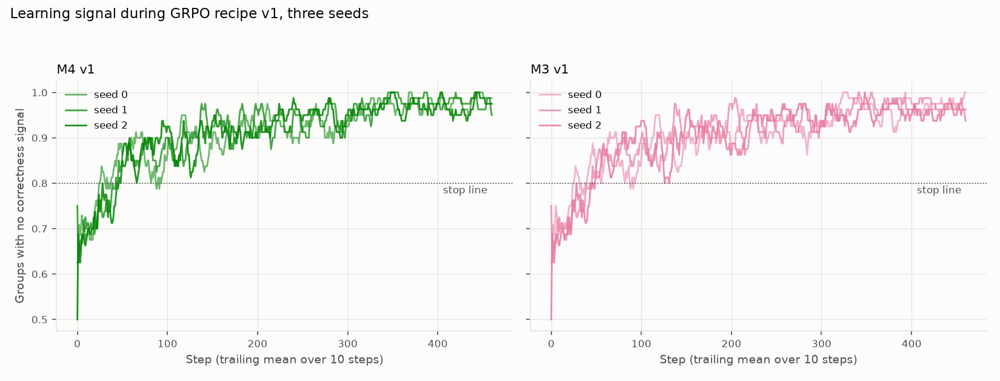

# Phase 4: three seeds of GRPO recipe v1, the test of M5-logit, and the evidence runs

## Training

Recipe v1: the strata come from M1's sampling pass and stay fixed. Seed 0 of M3 and M4 is the Milestone 4 run, and seed 0 of M5 the Milestone 5 run.

| Arm | Steps | Minutes | Groups with no correctness signal: all, first third, last third | Groups trained per step | Accuracy, first → last 25 | Brier, first → last 25 |
|---|---:|---:|---|---:|---|---|
| M4 v1 s0 | 461 | 285 | 91.5%, 84.7%, 97.6% | 7.9 | 0.882 → 0.961 | 0.099 → 0.038 |
| M4 v1 s1 | 461 | 285 | 91.8%, 84.4%, 97.6% | 7.9 | 0.883 → 0.929 | 0.102 → 0.062 |
| M4 v1 s2 | 461 | 279 | 91.5%, 84.0%, 96.8% | 7.2 | 0.891 → 0.958 | 0.091 → 0.039 |
| M3 v1 s0 | 461 | 113 | 90.9%, 84.2%, 96.8% | 0.7 | 0.879 → 0.955 | 0.103 → 0.045 |
| M3 v1 s1 | 461 | 113 | 91.3%, 83.7%, 96.9% | 0.7 | 0.884 → 0.936 | 0.102 → 0.061 |
| M3 v1 s2 | 461 | 114 | 90.7%, 83.6%, 95.6% | 0.7 | 0.891 → 0.953 | 0.092 → 0.045 |

| M5 seed | Steps | Minutes | Final training loss |
|---|---:|---:|---:|
| 0 | 217 | 29 | 0.3036 |
| 1 | 217 | 29 | 0.3032 |
| 2 | 217 | 29 | 0.3023 |

## Primary comparison (fixed before any Milestone 6 run)

The mean over seeds 0–2 of the M4 v1 minus M2-logit difference, held-out test, redacted text, clean items, both attributes pooled. M4 counts as better if the 95% interval of the Brier difference lies below zero and the lower bound of the accuracy difference is above −1 point.

| Difference | Estimate | 95% interval | Criterion | Met |
|---|---:|---|---|---|
| Brier, M4 v1 minus M2-logit, mean of seeds 0–2 | +0.0042 | -0.0031 to +0.0104 | interval below 0 | no |
| Accuracy, M4 v1 minus M2-logit, mean of seeds 0–2 | +0.0087 | +0.0029 to +0.0146 | lower bound above −0.01 | yes |

**Verdict: M4 v1 does not count as better than M2-logit.**

## The test of M5-logit (fixed before any Milestone 6 run)

M5's own letter probabilities with a temperature fitted on its map-fitting predictions had the best held-out Brier score of any method in Milestone 5, a result found after the results were seen. It is tested here on two new training runs: the mean over seeds 1 and 2 of the M5-logit minus M2-logit difference, with the same rule. Seed 0 is reported below but left out of the test. The test set is the one the hypothesis was found on.

| Difference | Estimate | 95% interval | Criterion | Met |
|---|---:|---|---|---|
| Brier, M5-logit minus M2-logit, mean of seeds 1–2 | -0.0047 | -0.0111 to +0.0017 | interval below 0 | no |
| Accuracy, M5-logit minus M2-logit, mean of seeds 1–2 | +0.0032 | -0.0033 to +0.0097 | lower bound above −0.01 | yes |

**Verdict: M5-logit does not count as better than M2-logit.**

Sensitivity: in some draws a refitted temperature runs to the edge of its search range, because the resampled map-fitting families hold almost no wrong answers. Draws per run: m1 2, m5 25, m5_s1 59, m5_s2 71. Without those draws, the Brier intervals are M4 v1 minus M2-logit: -0.0031 to +0.0104; M5-logit minus M2-logit: -0.0111 to +0.0017.

## Other comparisons, redacted text, clean items

Paired family bootstrap (10,000 draws), the same draws for every model; every draw refits M2's map, M2-logit's temperature and each M5 seed's temperature. Negative Brier differences favour the first method.

| Split | Difference | Estimate | 95% interval | Undefined draws |
|---|---|---:|---|---:|
| Seen test | Brier, M4 v1 minus M2-logit, mean of seeds 0–2 | +0.0003 | -0.0024 to +0.0031 | 0 |
| Seen test | Accuracy, M4 v1 minus M2-logit, mean of seeds 0–2 | +0.0008 | -0.0031 to +0.0049 | 0 |
| Seen test | Brier, M5-logit minus M2-logit, mean of seeds 1–2 | -0.0022 | -0.0042 to -0.0001 | 0 |
| Seen test | Accuracy, M5-logit minus M2-logit, mean of seeds 1–2 | +0.0018 | -0.0023 to +0.0062 | 0 |
| Seen test | Brier, M4 v1 minus M3 v1, mean of seeds | -0.0010 | -0.0022 to +0.0003 | 0 |
| Seen test | Brier, M4 v1 minus M2, mean of seeds | -0.0018 | -0.0073 to +0.0013 | 0 |
| Seen test | AUROC, M4 v1 minus M2-logit, mean of seeds | -0.0490 | -0.0908 to -0.0073 | 0 |
| Seen test | Accuracy, M4 v1 minus M3 v1, mean of seeds | -0.0012 | -0.0027 to +0.0000 | 0 |
| Seen test | Accuracy, M3 v1 minus M1, mean of seeds | +0.0020 | -0.0018 to +0.0060 | 0 |
| Seen test | Brier, M5 minus M2-logit, mean of seeds | +0.0112 | +0.0060 to +0.0172 | 0 |
| Seen test | AUROC, M5 minus M2-logit, mean of seeds | -0.0034 | -0.0262 to +0.0339 | 0 |
| Seen test | AUROC, M5-logit minus M2-logit, mean of seeds 1–2 | +0.0095 | -0.0393 to +0.0416 | 0 |
| Seen test | Brier, M4 v1 s0 minus M2-logit | -0.0007 | -0.0036 to +0.0021 | 0 |
| Seen test | Brier, M4 v1 s1 minus M2-logit | +0.0005 | -0.0025 to +0.0037 | 0 |
| Seen test | Brier, M4 v1 s2 minus M2-logit | +0.0013 | -0.0017 to +0.0044 | 0 |
| Seen test | Brier, M5-logit s0 minus M2-logit | -0.0009 | -0.0032 to +0.0018 | 0 |
| Seen test | Brier, M5-logit s1 minus M2-logit | -0.0020 | -0.0040 to +0.0001 | 0 |
| Seen test | Brier, M5-logit s2 minus M2-logit | -0.0024 | -0.0045 to -0.0002 | 0 |
| Held-out test | Brier, M4 v1 minus M2-logit, mean of seeds 0–2 | +0.0042 | -0.0031 to +0.0104 | 0 |
| Held-out test | Accuracy, M4 v1 minus M2-logit, mean of seeds 0–2 | +0.0087 | +0.0029 to +0.0146 | 0 |
| Held-out test | Brier, M5-logit minus M2-logit, mean of seeds 1–2 | -0.0047 | -0.0111 to +0.0017 | 0 |
| Held-out test | Accuracy, M5-logit minus M2-logit, mean of seeds 1–2 | +0.0032 | -0.0033 to +0.0097 | 0 |
| Held-out test | Brier, M4 v1 minus M3 v1, mean of seeds | -0.0120 | -0.0151 to -0.0091 | 0 |
| Held-out test | Brier, M4 v1 minus M2, mean of seeds | -0.0162 | -0.0485 to -0.0068 | 0 |
| Held-out test | AUROC, M4 v1 minus M2-logit, mean of seeds | -0.0646 | -0.0827 to -0.0449 | 0 |
| Held-out test | Accuracy, M4 v1 minus M3 v1, mean of seeds | +0.0044 | +0.0014 to +0.0075 | 0 |
| Held-out test | Accuracy, M3 v1 minus M1, mean of seeds | +0.0043 | -0.0010 to +0.0097 | 0 |
| Held-out test | Brier, M5 minus M2-logit, mean of seeds | +0.0220 | +0.0144 to +0.0291 | 0 |
| Held-out test | AUROC, M5 minus M2-logit, mean of seeds | -0.0270 | -0.0411 to -0.0096 | 0 |
| Held-out test | AUROC, M5-logit minus M2-logit, mean of seeds 1–2 | -0.0064 | -0.0239 to +0.0083 | 0 |
| Held-out test | Brier, M4 v1 s0 minus M2-logit | -0.0061 | -0.0136 to +0.0004 | 0 |
| Held-out test | Brier, M4 v1 s1 minus M2-logit | +0.0131 | +0.0049 to +0.0205 | 0 |
| Held-out test | Brier, M4 v1 s2 minus M2-logit | +0.0057 | -0.0024 to +0.0130 | 0 |
| Held-out test | Brier, M5-logit s0 minus M2-logit | -0.0070 | -0.0127 to -0.0015 | 0 |
| Held-out test | Brier, M5-logit s1 minus M2-logit | -0.0034 | -0.0097 to +0.0032 | 0 |
| Held-out test | Brier, M5-logit s2 minus M2-logit | -0.0061 | -0.0126 to +0.0004 | 0 |

## Results, held-out and seen test, redacted text, clean items

Pooled over both attributes; each attribute and text condition uses its own maps and threshold.

| Split | Method | Accuracy | Brier, invalid = 1 | ECE | AUROC | Risk–coverage area | Coverage at threshold | Error at threshold |
|---|---|---:|---:|---:|---:|---:|---:|---:|
| Seen test | M0 | 93.8% | 0.059 | 0.012 | 0.500 | 0.062 | 0.1% | 0.0% |
| Seen test | M1 | 98.4% | 0.016 | 0.034 | 0.655 | 0.010 | 100.0% | 1.6% |
| Seen test | M2 | 98.4% | 0.015 | 0.013 | 0.699 | 0.009 | 100.0% | 1.6% |
| Seen test | M2-logit | 98.4% | 0.013 | 0.010 | 0.949 | 0.001 | 100.0% | 1.6% |
| Seen test | M4 v1 s0 | 98.6% | 0.012 | 0.016 | 0.875 | 0.003 | 100.0% | 1.4% |
| Seen test | M4 v1 s1 | 98.5% | 0.014 | 0.019 | 0.912 | 0.003 | 100.0% | 1.5% |
| Seen test | M4 v1 s2 | 98.4% | 0.014 | 0.016 | 0.913 | 0.002 | 99.8% | 1.5% |
| Seen test | M3 v1 s0 | 98.7% | 0.015 | 0.061 | 0.879 | 0.002 | 100.0% | 1.3% |
| Seen test | M3 v1 s1 | 98.6% | 0.014 | 0.003 | 0.600 | 0.009 | 100.0% | 1.4% |
| Seen test | M3 v1 s2 | 98.5% | 0.015 | 0.001 | 0.674 | 0.007 | 100.0% | 1.5% |
| Seen test | M5 s0 | 98.5% | 0.023 | 0.029 | 0.931 | 0.002 | 100.0% | 1.5% |
| Seen test | M5 s1 | 98.5% | 0.025 | 0.030 | 0.954 | 0.001 | 100.0% | 1.5% |
| Seen test | M5 s2 | 98.6% | 0.025 | 0.032 | 0.952 | 0.001 | 100.0% | 1.4% |
| Seen test | M5-logit s0 | 98.5% | 0.012 | 0.010 | 0.947 | 0.001 | 99.8% | 1.5% |
| Seen test | M5-logit s1 | 98.5% | 0.011 | 0.011 | 0.959 | 0.001 | 99.9% | 1.4% |
| Seen test | M5-logit s2 | 98.6% | 0.011 | 0.007 | 0.958 | 0.001 | 100.0% | 1.4% |
| Held-out test | M0 | 82.8% | 0.158 | 0.122 | 0.503 | 0.171 | 0.1% | 0.0% |
| Held-out test | M1 | 89.3% | 0.096 | 0.051 | 0.631 | 0.077 | 99.5% | 10.6% |
| Held-out test | M2 | 89.3% | 0.099 | 0.080 | 0.747 | 0.046 | 99.5% | 10.6% |
| Held-out test | M2-logit | 89.3% | 0.078 | 0.040 | 0.862 | 0.025 | 99.7% | 10.5% |
| Held-out test | M4 v1 s0 | 91.3% | 0.072 | 0.015 | 0.789 | 0.030 | 99.8% | 8.6% |
| Held-out test | M4 v1 s1 | 89.2% | 0.091 | 0.045 | 0.795 | 0.035 | 99.8% | 10.8% |
| Held-out test | M4 v1 s2 | 90.1% | 0.084 | 0.042 | 0.807 | 0.032 | 99.3% | 9.7% |
| Held-out test | M3 v1 s0 | 90.1% | 0.084 | 0.038 | 0.701 | 0.050 | 100.0% | 9.9% |
| Held-out test | M3 v1 s1 | 89.9% | 0.098 | 0.082 | 0.522 | 0.088 | 100.0% | 10.1% |
| Held-out test | M3 v1 s2 | 89.3% | 0.103 | 0.087 | 0.537 | 0.086 | 100.0% | 10.7% |
| Held-out test | M5 s0 | 90.0% | 0.095 | 0.060 | 0.833 | 0.028 | 100.0% | 10.0% |
| Held-out test | M5 s1 | 89.3% | 0.101 | 0.064 | 0.834 | 0.029 | 100.0% | 10.7% |
| Held-out test | M5 s2 | 90.0% | 0.105 | 0.076 | 0.836 | 0.027 | 100.0% | 10.0% |
| Held-out test | M5-logit s0 | 90.0% | 0.071 | 0.012 | 0.852 | 0.025 | 99.6% | 9.8% |
| Held-out test | M5-logit s1 | 89.3% | 0.075 | 0.019 | 0.858 | 0.025 | 99.5% | 10.5% |
| Held-out test | M5-logit s2 | 90.0% | 0.072 | 0.017 | 0.852 | 0.024 | 99.3% | 9.6% |

## Spread over seeds, held-out test, redacted text, clean items

Mean over the three seeds, with the lowest and highest seed in brackets.

| Method | Accuracy | Brier, invalid = 1 | ECE | AUROC |
|---|---|---|---|---|
| M4 v1 | 90.2% (89.2% to 91.3%) | 0.083 (0.072 to 0.091) | 0.034 (0.015 to 0.045) | 0.797 (0.789 to 0.807) |
| M3 v1 | 89.8% (89.3% to 90.1%) | 0.095 (0.084 to 0.103) | 0.069 (0.038 to 0.087) | 0.587 (0.522 to 0.701) |
| M5 | 89.8% (89.3% to 90.0%) | 0.100 (0.095 to 0.105) | 0.067 (0.060 to 0.076) | 0.835 (0.833 to 0.836) |
| M5-logit | 89.8% (89.3% to 90.0%) | 0.073 (0.071 to 0.075) | 0.016 (0.012 to 0.019) | 0.854 (0.852 to 0.858) |

## Written values, held-out test, redacted text, clean items

| Model | Distinct values | Most common value | Its share | Share below 0.9 |
|---|---:|---:|---:|---:|
| M4 v1 s0 | 7 | 0.98 | 44.7% | 28.2% |
| M4 v1 s1 | 6 | 0.92 | 38.0% | 9.4% |
| M4 v1 s2 | 5 | 0.95 | 50.8% | 4.8% |
| M3 v1 s0 | 5 | 0.9 | 73.6% | 10.7% |
| M3 v1 s1 | 2 | 0.98 | 96.0% | 0.0% |
| M3 v1 s2 | 2 | 0.98 | 93.4% | 0.0% |
| M5 s0 | 10 | 0.94 | 28.0% | 52.6% |
| M5 s1 | 11 | 0.94 | 29.1% | 51.4% |
| M5 s2 | 11 | 0.94 | 34.3% | 51.2% |

How often each written value is right (values written at least 20 times):

| Model | Written confidence | Answers | Right |
|---|---:|---:|---:|
| M4 v1 s0 | 0.78 | 124 | 64.5% |
| M4 v1 s0 | 0.8 | 126 | 75.4% |
| M4 v1 s0 | 0.85 | 496 | 83.7% |
| M4 v1 s0 | 0.92 | 126 | 92.1% |
| M4 v1 s0 | 0.95 | 593 | 91.9% |
| M4 v1 s0 | 0.98 | 1,187 | 98.7% |
| M4 v1 s1 | 0.85 | 236 | 58.9% |
| M4 v1 s1 | 0.92 | 1,010 | 84.2% |
| M4 v1 s1 | 0.95 | 688 | 96.9% |
| M4 v1 s1 | 0.98 | 709 | 99.2% |
| M4 v1 s2 | 0.85 | 118 | 57.6% |
| M4 v1 s2 | 0.9 | 488 | 72.3% |
| M4 v1 s2 | 0.95 | 1,350 | 95.0% |
| M4 v1 s2 | 0.98 | 690 | 99.1% |

## Evidence runs, 1,000 clean held-out items (the photo-swap subset, unswapped)

Each model answers the same items with both photo and text, with the photo alone (text removed), and with the text alone (photo removed), in each text condition. A confidence that follows the evidence falls as far as accuracy does, so the gap stays near zero. M2-logit and M5-logit use the maps fitted on full evidence, as they would be in use. Descriptive; no decision rule.

| Model | Evidence | n | Accuracy | Invalid | Mean confidence | Confidence minus accuracy | AUROC |
|---|---|---:|---:|---:|---:|---:|---:|
| M0 | photo and full text | 1,000 | 93.6% | 0.0% | 0.950 | +0.014 | 0.505 |
| M0 | photo and redacted text | 1,000 | 79.2% | 0.0% | 0.950 | +0.158 | 0.501 |
| M0 | photo only | 1,000 | 79.1% | 0.0% | 0.950 | +0.159 | 0.500 |
| M0 | full text only | 1,000 | 90.6% | 0.0% | 0.935 | +0.029 | 0.746 |
| M0 | redacted text only | 1,000 | 52.4% | 0.0% | 0.801 | +0.277 | 0.622 |
| M1 | photo and full text | 1,000 | 95.8% | 0.0% | 0.949 | -0.009 | 0.713 |
| M1 | photo and redacted text | 1,000 | 87.7% | 0.0% | 0.944 | +0.067 | 0.623 |
| M1 | photo only | 1,000 | 86.7% | 0.0% | 0.945 | +0.078 | 0.610 |
| M1 | full text only | 1,000 | 91.7% | 0.0% | 0.940 | +0.023 | 0.882 |
| M1 | redacted text only | 1,000 | 50.9% | 0.0% | 0.868 | +0.359 | 0.593 |
| M2-logit | photo and full text | 1,000 | 95.8% | 0.0% | 0.946 | -0.012 | 0.920 |
| M2-logit | photo and redacted text | 1,000 | 87.7% | 0.0% | 0.834 | -0.043 | 0.849 |
| M2-logit | photo only | 1,000 | 86.7% | 0.0% | 0.831 | -0.036 | 0.847 |
| M2-logit | full text only | 1,000 | 91.7% | 0.0% | 0.919 | +0.002 | 0.968 |
| M2-logit | redacted text only | 1,000 | 50.9% | 0.0% | 0.604 | +0.095 | 0.688 |
| M4 v1 s0 | photo and full text | 1,000 | 96.1% | 0.0% | 0.967 | +0.006 | 0.882 |
| M4 v1 s0 | photo and redacted text | 1,000 | 90.2% | 0.0% | 0.923 | +0.021 | 0.770 |
| M4 v1 s0 | photo only | 1,000 | 90.2% | 0.0% | 0.923 | +0.021 | 0.758 |
| M4 v1 s0 | full text only | 1,000 | 92.4% | 0.0% | 0.943 | +0.019 | 0.945 |
| M4 v1 s0 | redacted text only | 1,000 | 53.1% | 0.0% | 0.779 | +0.248 | 0.600 |
| M5 s0 | photo and full text | 1,000 | 95.8% | 0.0% | 0.919 | -0.039 | 0.914 |
| M5 s0 | photo and redacted text | 1,000 | 88.6% | 0.0% | 0.825 | -0.061 | 0.823 |
| M5 s0 | photo only | 1,000 | 87.9% | 0.0% | 0.816 | -0.063 | 0.816 |
| M5 s0 | full text only | 1,000 | 92.1% | 0.0% | 0.859 | -0.062 | 0.946 |
| M5 s0 | redacted text only | 1,000 | 54.1% | 0.0% | 0.280 | -0.261 | 0.559 |
| M5-logit s0 | photo and full text | 1,000 | 95.8% | 0.0% | 0.966 | +0.008 | 0.906 |
| M5-logit s0 | photo and redacted text | 1,000 | 88.6% | 0.0% | 0.892 | +0.006 | 0.836 |
| M5-logit s0 | photo only | 1,000 | 87.9% | 0.0% | 0.886 | +0.007 | 0.837 |
| M5-logit s0 | full text only | 1,000 | 92.1% | 0.0% | 0.941 | +0.020 | 0.958 |
| M5-logit s0 | redacted text only | 1,000 | 54.1% | 0.0% | 0.722 | +0.181 | 0.673 |

## Photo swap, held-out test

Each item's text with another product's photo whose label differs (same category, another family). With full text the two disagree; with redacted text the photo is the only evidence of the label. Confidence is compared with the same items and condition unswapped. M4 v1 seed 0 has no swap run.

| Model | Text | n | Answers the text's label | Answers the photo's label | Other or invalid | Mean confidence, swapped | Mean confidence, unswapped |
|---|---|---:|---:|---:|---:|---:|---:|
| M0 | full | 1,000 | 43.2% | 46.7% | 10.1% | 0.946 | 0.950 |
| M0 | redacted | 1,000 | 6.8% | 72.4% | 20.8% | 0.946 | 0.950 |
| M1 | full | 1,000 | 61.5% | 35.1% | 3.4% | 0.940 | 0.949 |
| M1 | redacted | 1,000 | 5.4% | 82.8% | 11.8% | 0.930 | 0.944 |
| M2-logit | full | 1,000 | 61.5% | 35.1% | 3.4% | 0.739 | 0.946 |
| M2-logit | redacted | 1,000 | 5.4% | 82.8% | 11.8% | 0.775 | 0.834 |
| M4 v1 s1 | full | 1,000 | 72.5% | 24.9% | 2.6% | 0.912 | 0.966 |
| M4 v1 s1 | redacted | 1,000 | 5.1% | 84.7% | 10.2% | 0.891 | 0.934 |
| M4 v1 s2 | full | 1,000 | 69.0% | 28.7% | 2.3% | 0.924 | 0.967 |
| M4 v1 s2 | redacted | 1,000 | 5.7% | 85.6% | 8.7% | 0.896 | 0.941 |
| M3 v1 s1 | full | 1,000 | 64.5% | 32.6% | 2.9% | 0.980 | 0.982 |
| M3 v1 s1 | redacted | 1,000 | 5.7% | 84.2% | 10.1% | 0.980 | 0.980 |
| M3 v1 s2 | full | 1,000 | 68.1% | 29.3% | 2.6% | 0.980 | 0.984 |
| M3 v1 s2 | redacted | 1,000 | 5.1% | 85.2% | 9.7% | 0.980 | 0.980 |
| M5 s0 | full | 1,000 | 81.9% | 15.8% | 2.3% | 0.717 | 0.919 |
| M5 s0 | redacted | 1,000 | 5.9% | 85.1% | 9.0% | 0.586 | 0.825 |
| M5 s1 | full | 1,000 | 77.2% | 20.4% | 2.4% | 0.690 | 0.923 |
| M5 s1 | redacted | 1,000 | 6.2% | 84.3% | 9.5% | 0.583 | 0.814 |
| M5 s2 | full | 1,000 | 78.3% | 19.4% | 2.3% | 0.673 | 0.922 |
| M5 s2 | redacted | 1,000 | 6.5% | 84.1% | 9.4% | 0.647 | 0.826 |
| M5-logit s0 | full | 1,000 | 81.9% | 15.8% | 2.3% | 0.863 | 0.966 |
| M5-logit s0 | redacted | 1,000 | 5.9% | 85.1% | 9.0% | 0.825 | 0.892 |
| M5-logit s1 | full | 1,000 | 77.2% | 20.4% | 2.4% | 0.831 | 0.965 |
| M5-logit s1 | redacted | 1,000 | 6.2% | 84.3% | 9.5% | 0.831 | 0.897 |
| M5-logit s2 | full | 1,000 | 78.3% | 19.4% | 2.3% | 0.847 | 0.969 |
| M5-logit s2 | redacted | 1,000 | 6.5% | 84.1% | 9.4% | 0.834 | 0.904 |

## Figures

